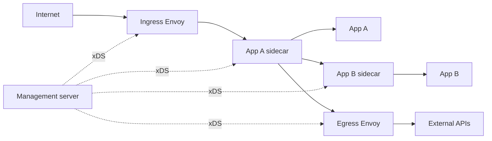

# Envoy Study Labs for a Cloud Traffic Engineer

This repository is a hands-on curriculum for mastering common Envoy configurations in ingress, sidecar, and egress roles. Use Envoy's v3 API. Start with Docker Compose, then repeat the capstone on Kubernetes. Do not introduce Istio or another service-mesh abstraction until the generated Envoy configuration is understandable without it.



## Standard lab environment

Build a reusable environment containing:

- A current stable Envoy image pinned to an exact version.
- Two HTTP services that return their service name, version, hostname, and request headers.
- One gRPC service.
- One deliberately slow or unhealthy service.
- `curl`, `grpcurl`, `openssl`, `jq`, and a load generator such as Fortio.
- An Envoy admin interface bound only to `127.0.0.1`.
- Separate files for listeners, clusters, routes, runtime, and secrets once the configuration becomes large.

For every lab, inspect Envoy's effective state:

```bash
curl -s localhost:9901/server_info
curl -s localhost:9901/config_dump
curl -s localhost:9901/clusters
curl -s localhost:9901/stats
curl -s "localhost:9901/stats?filter=^(http|cluster|listener)\."
```

Validate every configuration before starting Envoy:

```bash
envoy --mode validate -c /etc/envoy/envoy.yaml
```

## Lab 1 — Static reverse proxy

**Role:** Ingress  
**Goal:** Understand Envoy's fundamental configuration graph.

### Build

Configure:

- One listener on port `8080`.
- `envoy.filters.network.http_connection_manager`.
- One virtual host.
- A prefix route for `/`.
- One `STRICT_DNS` cluster with two backend instances.
- Round-robin load balancing.
- Console access logging.
- An admin interface on a loopback-only port.

### Tasks

1. Send ten requests and observe both backends receiving traffic.
2. Stop one backend and record what happens before and after health or DNS state changes.
3. Add `connect_timeout`.
4. Compare `STATIC`, `STRICT_DNS`, and `LOGICAL_DNS` cluster discovery.
5. Find the active listener, route, cluster, and endpoints in `config_dump`.

### Completion criteria

- Requests are distributed across both backends.
- An unknown route returns an Envoy-generated `404`.
- You can trace a request through `listener → filter chain → HTTP connection manager → route → cluster → endpoint`.

### Interview drill

Explain why an Envoy route references a cluster rather than an endpoint.

## Lab 2 — Virtual hosts and HTTP routing

**Role:** Ingress  
**Goal:** Master common routing behavior and route precedence.

### Build

Route traffic using:

- Host or domain matching.
- Exact, prefix, and safe-regex paths.
- Header matching.
- Query-parameter matching.
- Weighted clusters.
- Redirects and path rewrites.
- Request and response header manipulation.

Required behavior:

| Request | Destination |
|---|---|
| `Host: api.lab`, `/v1/*` | API v1 |
| `Host: api.lab`, `/v2/*` | API v2 |
| Header `x-user-group: beta` | Canary |
| `/legacy/*` | Redirect or rewrite |
| Unknown host | Explicit rejection |

### Tasks

1. Implement a 90/10 stable-to-canary split.
2. Make a beta header override the weighted split.
3. Rewrite `/public/catalog` to `/internal/catalog`.
4. Add `x-request-id` propagation.
5. Reject or route unknown hosts deliberately; do not depend on accidental fallback behavior.
6. Demonstrate how route order changes the selected route.

### Completion criteria

- A 1,000-request run approximates the configured weighting.
- Beta requests always reach the canary.
- Backend logs show the rewritten path and manipulated headers.
- Access logs identify the selected virtual host and route.

### Interview drill

Explain the difference between a virtual host, route, route match, weighted cluster, and filter-chain match.

## Lab 3 — Timeouts, retries, and failure budgets

**Role:** Ingress or sidecar  
**Goal:** Build resilience without causing retry storms.

### Build

Configure independently:

- Route timeout.
- Per-try timeout.
- Retry policy.
- Retry-on conditions.
- Maximum retry count.
- Retry host predicate or retry priority if supported by the selected Envoy version.
- Request hedging as an optional experiment.

Make the backend support delayed responses, `503` responses, connection resets, and a non-idempotent `POST`.

### Tasks

1. Apply a 2-second route timeout and a 500-ms per-try timeout.
2. Retry idempotent requests on selected connection, reset, or 5xx failures.
3. Do not blindly retry non-idempotent requests.
4. Pass `x-envoy-upstream-rq-timeout-ms` or a gRPC timeout and study timeout precedence.
5. Run load while making one endpoint slow.
6. Calculate maximum upstream request amplification from the retry settings.

### Completion criteria

- Slow requests terminate within the expected deadline.
- Retry counters identify the actual retry reason.
- Retries do not exceed the configured request budget.
- You can distinguish downstream timeout, upstream connection timeout, per-try timeout, and route timeout.

### Interview drill

Given three attempts with a 500-ms per-try timeout and a 1.2-second overall timeout, explain which deadline wins and why.

## Lab 4 — Health checks, outlier detection, and circuit breaking

**Role:** Sidecar or ingress  
**Goal:** Separate proactive health checking from passive failure detection.

### Build

Configure:

- Active HTTP health checks.
- Consecutive-5xx outlier detection.
- Ejection duration and maximum ejection percentage.
- Circuit-breaker thresholds for maximum connections, pending requests, active requests, and retries.
- Panic-threshold experiments.

### Tasks

1. Make one backend fail its health endpoint.
2. Make another backend pass health checks but return application `503` responses.
3. Observe which subsystem removes each endpoint.
4. Saturate a backend until Envoy rejects or queues requests.
5. Repeat with different pending-request limits.
6. Make enough hosts unhealthy to observe panic-mode behavior.

### Completion criteria

Show counters proving:

- Active health-check failure.
- Passive outlier ejection.
- Circuit-breaker overflow.
- Endpoint re-entry after recovery.

### Interview drill

Why can aggressive outlier detection make an outage worse when the entire dependency is degraded?

## Lab 5 — TLS ingress and downstream mTLS

**Role:** Ingress  
**Goal:** Terminate TLS correctly and authenticate clients.

### Build

Create a small CA and issue:

- An ingress server certificate.
- A valid client certificate.
- A certificate from an untrusted CA.
- An expired or hostname-invalid certificate for negative tests.

Configure:

- Downstream TLS termination.
- TLS 1.2 and TLS 1.3 policy.
- SNI-based filter chains for two hostnames.
- Client-certificate validation.
- SAN-based identity matching.
- Certificate details in access logs.

### Tasks

1. Serve two domains from one listener using SNI.
2. Require mTLS for an administrative hostname.
3. Reject a missing client certificate, untrusted client certificate, and incorrect server name.
4. Rotate a certificate without restarting Envoy; use SDS for the rotation exercise.
5. Confirm the negotiated protocol and certificate chain with `openssl s_client`.

### Completion criteria

- Public traffic succeeds with server-side TLS.
- Administrative traffic succeeds only for the intended client identity.
- Certificate rotation does not interrupt service.
- Envoy logs expose enough identity information to audit the decision.

### Interview drill

Distinguish SNI, `Host` or `:authority`, certificate SAN, filter-chain matching, and HTTP route matching.

## Lab 6 — Explicit sidecar mesh

**Role:** Sidecar  
**Goal:** Understand inbound and outbound proxy paths without a service-mesh product hiding them.

### Topology

For each service, run an application container and a colocated Envoy. Bind the application listener to loopback where practical.

### Tasks

1. Make App A call App B through A's outbound Envoy.
2. Make B accept traffic only through B's inbound Envoy.
3. Establish Envoy-to-Envoy mTLS.
4. Give each workload a distinct certificate identity.
5. Authorize A to call B but deny an unauthorized workload.
6. Preserve request IDs and distributed-tracing headers across both proxies.
7. Compare application-generated, outbound-sidecar, and inbound-sidecar errors.

### Completion criteria

- Direct access to B's application port is unavailable from another workload.
- A-to-B succeeds over mTLS.
- An unauthorized identity receives a deliberate denial.
- Logs from both sidecars correlate by request ID.
- You can identify which proxy generated every tested error response.

### Interview drill

Explain the security difference between encrypted traffic and a receiving workload authenticating and authorizing its caller.

## Lab 7 — Egress gateway and TLS origination

**Role:** Sidecar plus egress gateway  
**Goal:** Control external traffic and understand HTTP CONNECT and SNI constraints.

### Build

Permit external access only through an egress Envoy. Configure:

- Allowlisted external domains.
- DNS-based upstream clusters.
- Upstream TLS origination.
- SNI and certificate validation.
- Explicit denial for unknown destinations.
- Separate policy for HTTP, HTTPS, and optionally TCP tunneling.

### Tasks

1. Allow two external hostnames and deny a third.
2. Send plaintext HTTP from the application while Envoy originates upstream TLS.
3. Verify the upstream certificate SAN.
4. Break SNI intentionally and diagnose the failure.
5. Observe DNS changes and endpoint updates.
6. Choose and implement one HTTP CONNECT policy: deny it, allow only specific targets, or use a tightly controlled dynamic forward proxy.

### Completion criteria

- The application cannot bypass the egress path.
- Allowed destinations succeed with verified upstream TLS.
- Unknown destinations fail closed.
- Access logs contain destination, SNI, upstream host, response flags, and bytes transferred.

### Interview drill

Why is an unrestricted dynamic forward proxy a security boundary failure?

## Lab 8 — HTTP authorization, JWT, and rate limiting

**Role:** Ingress  
**Goal:** Compose HTTP filters in the correct order.

### Build

Use:

- JWT authentication filter.
- External authorization filter.
- Local rate-limit filter.
- Optional global rate-limit service.
- Router filter last.

Required policy:

- `/public`: no authentication.
- `/user`: valid JWT.
- `/admin`: valid JWT plus an authorization decision.
- Different limits by client identity or route.

### Tasks

1. Validate JWT issuer, audience, signature, and expiration.
2. Forward selected JWT claims as trusted headers.
3. Ensure clients cannot spoof those headers.
4. Implement an `ext_authz` service that permits or denies by identity and route.
5. Test fail-open versus fail-closed behavior when authorization is unavailable.
6. Add per-route rate limits.
7. Confirm denied requests never reach the application.

### Completion criteria

| Case | Expected result |
|---|---|
| Missing token | `401` |
| Invalid token | `401` |
| Authenticated but unauthorized | `403` |
| Authorized | Upstream response |
| Rate exceeded | `429` |
| Authorization service unavailable | Documented fail-open or fail-closed behavior |

### Interview drill

Why does HTTP filter order matter? Explain what can happen if header mutation, authentication, authorization, and routing are ordered incorrectly.

## Lab 9 — gRPC and HTTP/2

**Role:** Ingress or sidecar  
**Goal:** Operate protocols beyond basic HTTP/1.1.

### Build

Configure:

- Downstream HTTP/2 support.
- An upstream HTTP/2 cluster.
- gRPC service routing by service or method path.
- gRPC health checking when available.
- Optional gRPC-Web transcoding.

### Tasks

1. Call unary and streaming methods through Envoy.
2. Apply different timeouts to two methods.
3. Trigger a gRPC deadline-exceeded response.
4. Trigger an upstream reset during a stream.
5. Inspect gRPC status in access logs.
6. Compare the HTTP response status with `grpc-status`.

### Completion criteria

- Unary and streaming calls work through Envoy.
- Deadlines propagate correctly.
- Logs distinguish transport success from application-level gRPC failure.
- You can explain why HTTP `200` does not necessarily represent a successful gRPC operation.

## Lab 10 — L4 TCP proxy and TLS passthrough

**Role:** Ingress  
**Goal:** Handle traffic Envoy cannot or should not terminate at HTTP level.

### Build

Configure:

- `envoy.filters.network.tcp_proxy`.
- SNI inspection with `tls_inspector`.
- Multiple filter chains selected by server name.
- TCP idle timeout.
- Proxy Protocol as an optional extension.
- TLS passthrough to different upstream services.

### Tasks

1. Forward a raw TCP echo protocol.
2. Route TLS connections by SNI without terminating TLS.
3. Contrast downstream TLS termination with passthrough.
4. Trigger the idle timeout.
5. Test what happens when the client sends no SNI.
6. Verify original-client addressing with and without Proxy Protocol.

### Completion criteria

- Two TLS services share one ingress port and are selected by SNI.
- Certificates remain owned by the upstream services.
- Non-SNI behavior is deliberate rather than accidental.
- TCP connection metrics and logs identify connection-level success and failure.

### Interview drill

At TLS passthrough time, why can Envoy route on SNI but not on an HTTP path?

## Lab 11 — Observability and incident diagnosis

**Role:** All Envoy roles  
**Goal:** Diagnose failures without immediately reading application logs.

### Build

Configure a structured JSON access log containing:

- Timestamp and request ID.
- Authority, method, path, and protocol.
- Response code and response flags.
- Response-code details and connection-termination details.
- Bytes sent and received.
- Request duration and upstream service time.
- Upstream cluster and host.
- Retry count.
- Downstream and upstream TLS information.

Export metrics to Prometheus. Add tracing through OpenTelemetry if available.

### Fault-injection tasks

Create and diagnose:

1. No matching route.
2. No healthy upstream.
3. DNS resolution failure.
4. Upstream connection refusal.
5. TLS certificate-verification failure.
6. Upstream reset.
7. Route timeout.
8. Circuit-breaker overflow.
9. Authorization denial.
10. Local rate-limit rejection.

For each incident, record:

- Client-visible status.
- Response flags and details.
- Relevant counters.
- Relevant cluster state.
- Root cause.
- Minimum corrective change.

### Completion criteria

Given only Envoy logs, stats, and admin output, identify all ten injected failures.

### Interview drill

Explain how to distinguish routing failure, connection failure, timeout, reset, and local policy rejection. Learn response-flag concepts rather than merely memorizing codes.

## Lab 12 — xDS dynamic configuration

**Role:** Control plane  
**Goal:** Understand how production meshes configure Envoy.

### Build

Start with filesystem-based dynamic configuration. Then implement or run a small management server supporting:

- LDS.
- RDS.
- CDS.
- EDS.
- SDS where practical.

Use ADS after understanding each resource independently.

### Tasks

1. Update a route without restarting Envoy.
2. Add and remove an endpoint dynamically.
3. Push an invalid resource and observe rejection.
4. Inspect ACK and NACK behavior and error details.
5. Test resource versioning and nonces.
6. Restart the management server while proxies continue serving.
7. Remove a referenced cluster and observe resource dependency and ordering behavior.
8. Compare state-of-the-world and delta xDS.

### Completion criteria

- Valid updates become active without process restarts.
- Invalid updates leave the last valid configuration serving.
- The management server records ACKs and NACKs.
- You can explain warming, resource dependencies, eventual consistency, and stale configuration.

### Interview drill

An xDS server pushed a route referencing a missing cluster. Explain possible rejection or warming behavior and how to investigate it.

# Capstone — Production-style service mesh

Build the complete ingress, sidecar, egress, and management-server topology shown at the top of this document.

## Ingress requirements

- TLS termination.
- Public and administrative virtual hosts.
- JWT authentication.
- External authorization for administrative routes.
- Stable and canary weighted routing.
- Route-specific timeouts and retries.
- Global or local rate limiting.

## Sidecar requirements

- Explicit inbound and outbound listeners.
- Workload-to-workload mTLS.
- Service-identity authorization.
- Active health checks and outlier detection.
- Circuit breakers.
- Correlated access logs and tracing.

## Egress requirements

- External-domain allowlist.
- TLS origination with SAN validation.
- Closed-by-default policy.
- Auditable destination logs.

## Control-plane requirements

- Dynamic routes, clusters, and endpoints.
- Safe rejection of invalid configuration.
- Endpoint removal without an Envoy restart.

## Failure exercise

During continuous traffic:

1. Deploy a canary.
2. Shift it from 0% to 10%, 50%, and 100%.
3. Make the canary slow.
4. Observe timeouts and outlier detection.
5. Roll traffic back dynamically.
6. Expire or rotate a workload certificate.
7. Stop the authorization service.
8. Stop the xDS server.
9. Remove one backend.
10. Prove which traffic continued, failed open, or failed closed.

Write a short incident report using only collected evidence.

# Knowledge checklist

After completing the labs, be able to explain the following areas without relying on generated service-mesh configuration:

| Area | Envoy concepts |
|---|---|
| Traffic entry | Listener, socket address, listener filters, filter chains |
| HTTP processing | HTTP connection manager, HTTP filters, codec options |
| Routing | Virtual hosts, domains, route matching, weighted clusters |
| Service discovery | STATIC, STRICT_DNS, LOGICAL_DNS, EDS |
| Load balancing | Round robin, least request, ring hash, Maglev |
| Resilience | Timeouts, retries, hedging, circuit breakers |
| Endpoint management | Health checks, outlier detection, panic threshold |
| Security | TLS context, validation context, SDS, SAN, SNI, mTLS |
| Policy | JWT, external authorization, rate limiting |
| Protocols | HTTP/1.1, HTTP/2, gRPC, TCP proxy |
| Dynamic configuration | LDS, RDS, CDS, EDS, SDS, ADS |
| Operations | Admin API, config dump, stats, logs, response flags |
| Mesh design | Ingress, sidecar, egress, identity, policy boundaries |

## Definition of done for every lab

A lab is not complete merely because requests succeed. For each lab, answer with observed evidence:

1. Which listener and filter handled the connection?
2. Which route matched?
3. Which cluster and endpoint were selected?
4. Which timeout and retry budgets applied?
5. Which identity was authenticated and authorized?
6. Which metric or log proves the conclusion?
7. What happens if every dependency involved becomes unavailable?
